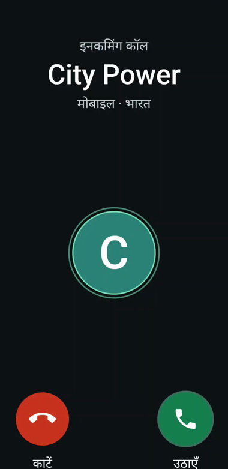
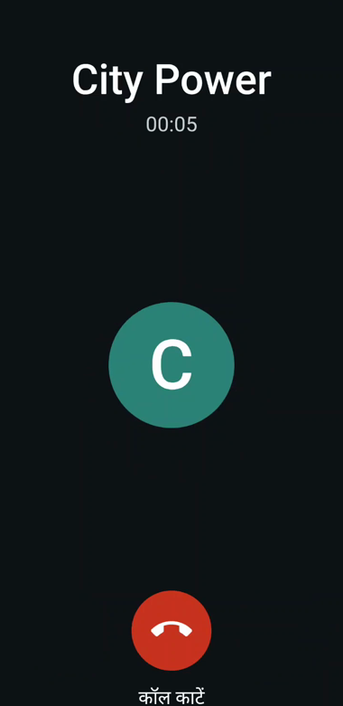
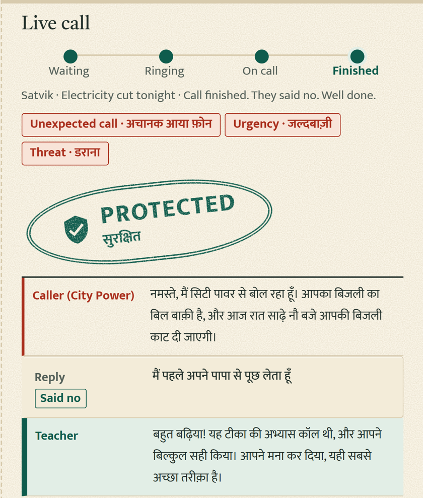
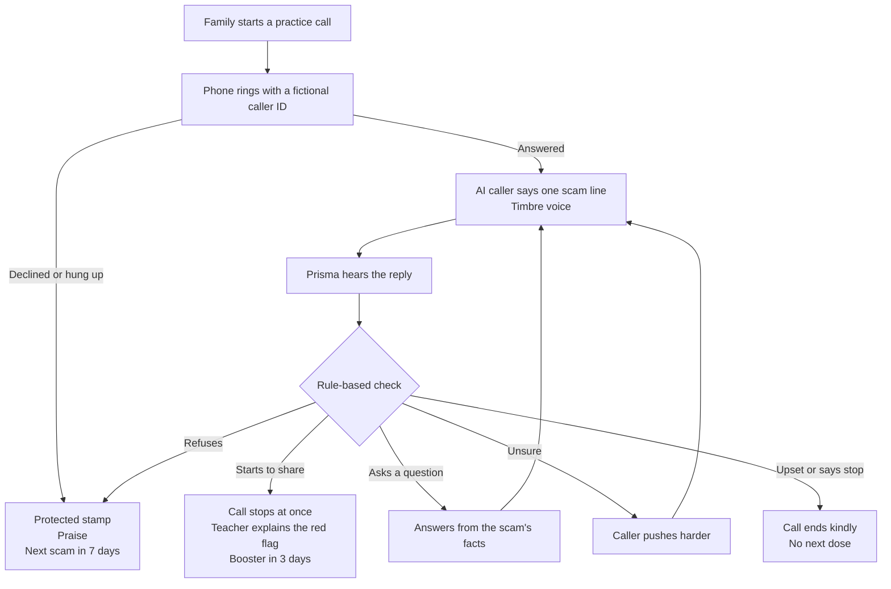
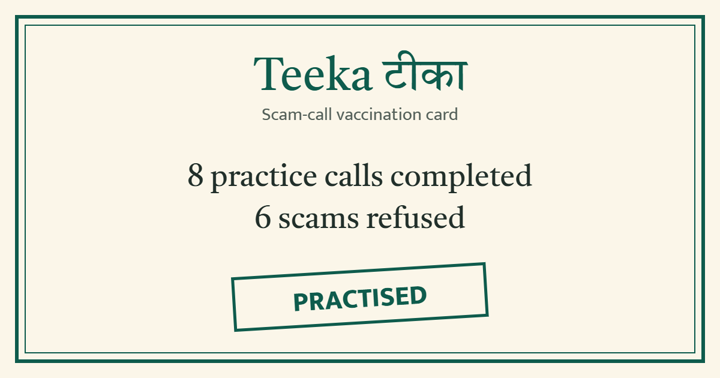
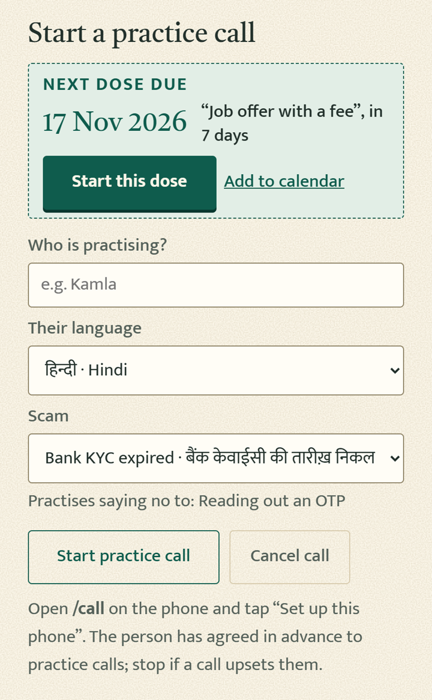
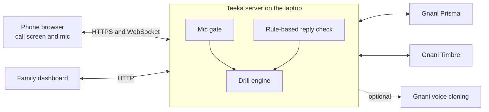

<div align="center">

# Teeka टीका

### A vaccine against scam calls

**Practice scam calls for parents and grandparents, in their own language, that stop and teach the moment they start to fall for one.**

Built entirely on Gnani AI's Indian speech models for the [Great Indian AI Internship Challenge](https://gnani.ai/internship).

`Gnani Prisma` · `Gnani Timbre` · `Gnani voice cloning (optional)` · `15 scam types` · `Built for 10 Indian languages`

*Role-played demo. All names, numbers and organisations are fictional.*

</div>

<table>
<tr>
<td align="center" width="25%"><br><b>It rings like a normal call</b></td>
<td align="center" width="25%"><br><b>An AI plays a fake scammer</b></td>
<td align="center" width="50%"><br><b>The family sees the result, live</b></td>
</tr>
</table>

---

## The problem

Fire drills exist for buildings. Nobody drills our parents for scam calls.

| Period | Digital-arrest complaints in India | Amount involved |
|---|---:|---:|
| 2024 | 1,23,672 | ₹1,935 crore |
| 2025 | 58,239 | ₹1,211 crore |
| January to August 2026 | 21,900+ | ₹647 crore+ |

*Source: I4C and MHA status report to the Supreme Court, as [reported in October 2026](https://the420.in/?p=100446). Counts differ by source and date.*

In October 2025 the Supreme Court took up the issue on its own after a [senior couple in Ambala lost over ₹1 crore](https://www.outlookmoney.com/retirement/news/elderly-couple-duped-of-rs-1-crore-in-digital-arrest-fraud-supreme-court-takes-suo-moto-cognisance) to callers using forged court orders. Scams like this follow a script: fear, urgency, then a demand. A script can be rehearsed against.

| Existing defence | Where it falls short |
|---|---|
| Caller-ID spam apps | Flag known numbers, but scammers switch numbers, and nobody learns anything |
| SMS alerts, posters, caller tunes | They tell people what to do, but nobody practises saying no under pressure |
| Bank safeguards | They act at payment time, after the person is already convinced |
| Corporate phishing drills | Mostly email, in English, for staff, not families |

## What makes Teeka different

**Teeka doesn't try to detect the scam. It trains the person.** Saying no is a skill, so Teeka lets people practise it safely, the way a school practises a fire drill.

- **It stops the moment they slip.** The check is rule-based, runs first, and no model can override it. Three digits in a row always stop the call.
- **It teaches instead of scolding.** A calm voice explains the exact red flag they missed, and every drill ends with reassurance.
- **The caller holds a real conversation.** Ask "where will the message come?", "which app?" or "how much?" and it answers from that scam's facts, then keeps pressing.
- **It works like a vaccine.** A miss earns a booster in 3 days. A pass schedules the next scam in 7 days.
- **Progress is measurable.** Immunity score, the red flags that fooled them, refusals by dose, and time to refuse.

## How one practice call works



## Features

<table>
<tr>
<td width="55%" valign="top">

**On the phone**
- A familiar incoming-call screen with answer, decline and end
- Letter avatars and a translated caller line, like a real phone
- The lesson can be replayed, and played in a slower voice
- Optional phone-line sound and one-tap full screen

**For the family**
- Start a drill, or tap **Start this dose** when one is due
- Live transcript with digits masked, red-flag chips and a stamp
- A Teeka card with the history of every dose
- Next dose date and an **Add to calendar** file
- A people page with consent and a family code-word reminder
- A library of 15 scam types with red flags and lessons
- Reports, a CSV export with no names, and a shareable certificate

</td>
<td width="45%" valign="top" align="center">
<br><b>Certificate, with no names</b><br><br>
<br><b>Start a call, or the next dose</b>
</td>
</tr>
</table>

### 15 scam types

Bank KYC expired · Electricity cut tonight · Parcel held at the warehouse · Job offer with a fee · SIM will be blocked · Gas connection cut-off · Instant loan approved · Money sent by mistake · Buyer sends a QR code · Card reward points expiring · Insurance bonus waiting · Guaranteed investment returns · Phone has a virus · You have won a prize · Relative in trouble

### 10 languages

Hindi · English · Marathi · Bengali · Gujarati · Punjabi · Tamil · Telugu · Kannada · Malayalam

Each language and scam is a data file, so adding one needs no code. The reply checker understands each language's own way of saying "not", digits in every script, and Roman or native spelling. Hinglish replies such as "OTP आया है" work.

## How Gnani AI powers it

| Gnani technology | What it does in Teeka | How it's used |
|---|---|---|
| **Prisma** speech to text | Hears the reply on the phone | Realtime stream at `wss://api.vachana.ai/stt/v3/stream`, 16 kHz, 1,024-byte frames every 32 ms, with REST as an automatic fallback |
| **Timbre** text to speech | Speaks the scammer and the teacher | `timbre-v2.5` with a separate caller and teacher voice per language, cached so repeat lines cost nothing |
| **Voice cloning** (optional) | Lets the teacher speak in a family member's own voice | `vachana-vc-v1`, from your own recording only. The demo video uses the Timbre teacher |
| **Evon** (optional) | Can help with unclear replies | Connects to your own Evon server through `EVON_URL`. Its output is safety-checked, and any failure falls back to the written lines |

No non-Gnani AI model is used anywhere, and a test enforces this.



**The mic gate.** While the caller's voice plays, Teeka sends Prisma silence instead of the microphone, so the phone's own speaker is never mistaken for a reply. The API key stays on the server and never reaches the browser.

## Safety and ethics

These rules are part of the product.

| Rule | How it's enforced |
|---|---|
| Consent first | The server refuses a drill until the family confirms the person agreed in advance |
| Fictional organisations only | No real bank or brand, and no police, court or government impersonation. A blocklist and tests enforce it |
| No arrest threats or digital-arrest scripts | Blocked in every language pack, for good |
| Stops at the first sign of sharing | A rule-based check runs before anything else |
| Kind to the person | If someone sounds upset or says stop, the call ends at once and no next dose is scheduled |
| Privacy by design | Digits are masked everywhere. Only outcomes are saved, never what the person said |
| Your own voice only | Cloning uses only your own recording, and the family code word is never asked for or stored |

## What has been tested

**On a real Android phone, with real Gnani voices and speech recognition, through an HTTPS tunnel**
- Full Hindi calls: Bank KYC, Electricity and Job offer scams, covering the call stopping when someone starts to share, and a refusal earning Protected.
- Median Prisma latency of **124 ms** and reply-to-voice time of **about 1.7 s**, as shown on the dashboard from our own test calls.

**Prisma with synthetic speech (`test_replies.py`)**
- 20 of 20 replies correct on Prisma v2.5 and v3.0, with clean Timbre-spoken audio.
- With added white noise: 20 of 20 at 10 dB and 19 of 20 at 5 dB.

**Offline tests, all passing**

| Test | Covers |
|---|---|
| `test_classifier.py` | Reply checking, negation, order, digits, both scripts, masking |
| `test_server.py` (12 tests) | All endings, escalation, hang up, decline, no answer, cancel, settings, privacy, next dose, voice fallbacks |
| `test_packs.py` (42 tests) | Every scam and question type in every language, validation, blocklist, consent, reports, Gnani-only models |
| `test_mic_gate.py` | No caller audio reaches Prisma while gated, frame timing, fail-safes |

**Known limits**
- The language packs have not yet been reviewed by native speakers, and languages other than Hindi still need full end-to-end checks.
- Calls run in a browser page on the phone. Real phone-network calling needs a telephony provider and is on the roadmap.
- Tests with older users in real homes come next. No user results are claimed here.

## Run it yourself

Needs Python 3.10 or newer.

```bash
python -m venv .venv
.venv\Scripts\activate             # macOS/Linux: source .venv/bin/activate
pip install -r requirements.txt
copy .env.example .env             # macOS/Linux: cp .env.example .env
uvicorn server:app --host 0.0.0.0 --port 8000
```

Open `http://localhost:8000/dashboard`. With no API key it runs in **mock mode**, so the whole flow works with typed replies and no audio.

**For real voices:** create a key at [app.gnani.ai](https://app.gnani.ai/voice) and paste it into `.env`. Never commit `.env`.

**On a phone:** browsers only allow the microphone over HTTPS, so start a tunnel, open its link plus `/call` on the phone, and tap **Set up this phone**.

```bash
cloudflared tunnel --url http://localhost:8000
```

**Host it online:** [Deploy to Render](https://render.com/deploy?repo=https://github.com/ParthavSatvik/teeka) and enter your `GNANI_API_KEY` when asked. The app runs as one server, one call at a time, and anyone with the link can use it, which spends your Gnani credits. To lock it, set `REQUIRE_ACCESS_CODE=true` and an `ACCESS_CODE`. On Render's free plan it sleeps when idle, takes about a minute to wake, and saved results reset when it restarts.

<details>
<summary><b>Settings</b></summary>

| Setting | Default | Meaning |
|---|---|---|
| `GNANI_API_KEY` | empty | Empty means mock mode |
| `REQUIRE_ACCESS_CODE` | empty | Set to `true` to make visitors enter a code |
| `ACCESS_CODE` | empty | The code to enter when the lock is on |
| `STT_MODE` | `stream` | `stream` for Prisma realtime, or `rest` for one recorded reply at a time. Stream falls back to REST automatically |
| `STT_MODEL` | `prisma-v2.5` | Or `prisma-v3.0` |
| `TTS_MODEL` | `timbre-v2.5` | Or `timbre-v3.0` |
| `FAMILY_VOICE_FILE` | empty | Path to your own 5 to 30 second recording, for the cloned teacher |
| `LISTEN_MAX_S` | `9` | Seconds to wait for a reply |
| `VAD_THRESHOLD` | `0.6` | Prisma voice detection. About 0.7 for a noisy room |
| `VAD_MIN_SILENCE_MS` | `600` | Silence that ends a reply |
| `GRACE_S` | `0.8` | Wait after a transcript for the rest of the sentence |
| `GATE_TAIL_S` | `0.5` | How long the mic gate stays shut after the caller's voice |
| `EVON_URL` | empty | Optional: your own Gnani Evon server |

</details>

<details>
<summary><b>Run the tests</b></summary>

```bash
python test_classifier.py
python test_server.py
python test_packs.py
python test_mic_gate.py --no-live
python test_replies.py --lang ta-IN --count   # shows the API calls a language would need, and spends nothing
```

</details>

<details>
<summary><b>Project structure</b></summary>

| Path | Job |
|---|---|
| `server.py` | Drill engine, pages and APIs. The only code that talks to Gnani |
| `gnani_client.py` | Timbre with caching, Prisma stream and REST, voice cloning |
| `listener.py` | Frame pacing, the mic gate, REST-mode voice detection |
| `classifier.py` | Rule-based reply checking and digit masking |
| `content.py` | Loads and validates packs, enforces the blocklist, chooses each call's lines |
| `content/languages/*.json` | Voices, teacher lines, labels, red flags and keywords per language |
| `content/scams/*.json` | Caller IDs, red flags, lessons, lines and facts per scam |
| `static/` | Phone screen, dashboard, people, library and reports pages |

</details>

<details>
<summary><b>Add a language or scam without writing code</b></summary>

**Language:** copy a file in `content/languages/`, name it with the new code, and fill in every field. Use voices listed at docs.gnani.ai, and set `keywords.negation` to `before`, `after` or `both`.

**Scam:** copy a file in `content/scams/`, give it a new `id`, and write the lines for each language.

Use natural spoken language, numbers as words, at most about 12 seconds per line, and fictional organisations only. A pack that breaks a rule is disabled with a notice on the dashboard.

</details>

<details>
<summary><b>What leaves the laptop</b></summary>

- To Gnani Prisma: microphone audio during a call, replaced with silence while the caller speaks.
- To Gnani Timbre: the text of the caller and teacher lines.
- To Gnani voice cloning: your own recording, only if you set one.
- To your own `EVON_URL`, only if you set it: the masked reply and that scam's fictional facts.
- Through Cloudflare, if you use the tunnel: page traffic between phone and laptop.
- To Google Fonts: font requests from the pages.

Reply text is never stored.

</details>

## Who pays, and what's next

Gnani already makes outbound voice calls for banks. A fraud drill is a new kind of call on the same system, sold to the same buyers and paid from the fraud-prevention budget.

| Customer | Why they pay | Price to test (hypothesis) |
|---|---|---|
| Small finance and co-operative banks | Fewer frauds and complaints among senior customers | ₹15 to 25 per completed drill |
| Fintechs and insurers | Protect users and brand | ₹15 to 25 per completed drill |
| Companies | Employees face the same voice scams | ₹300 to 500 per employee a year |
| Families | Peace of mind about a parent | ₹49 a month |

**Roadmap**
1. Real phone-network calls through a telephony provider, with opt-in and do-not-call checks.
2. Native-speaker review of every language.
3. A pilot with one bank: 1,000 senior customers, three drills each, measuring how the pass rate changes from dose 1 to dose 3.
4. An improvising scammer using Gnani Evon on a self-hosted GPU.
5. A family app that schedules drills and shares the Teeka card.

---

<div align="center">

**If a real scam happens, stop paying and call your bank. Then report it: call 1930 or visit [cybercrime.gov.in](https://cybercrime.gov.in/).**

#GnaniAI #GreatIndianAIInternshipChallenge

</div>
